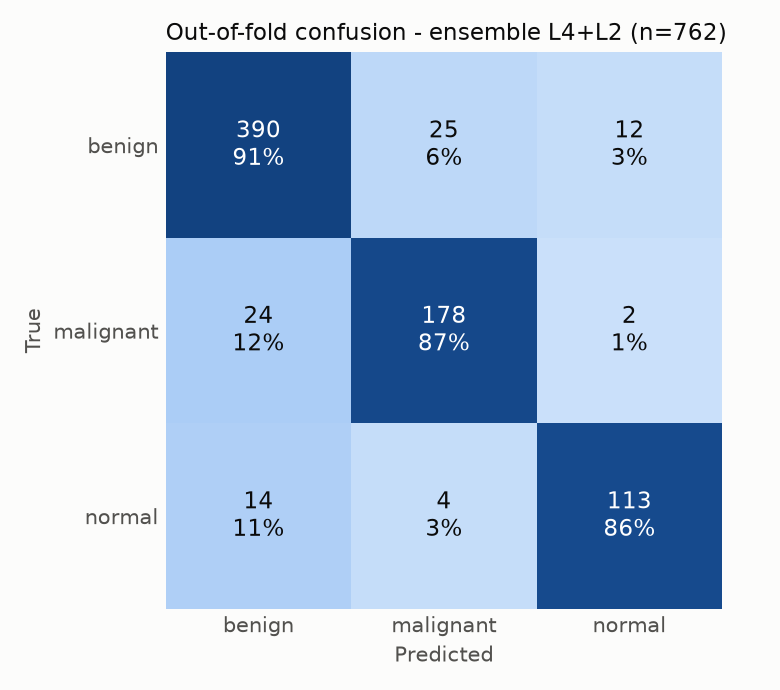
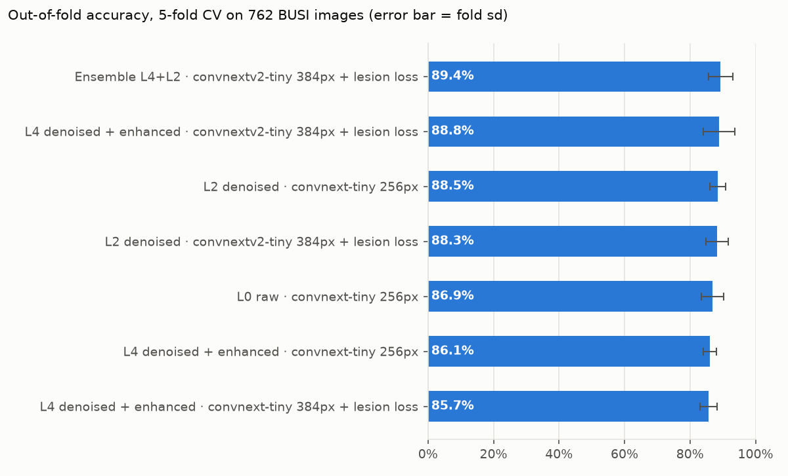
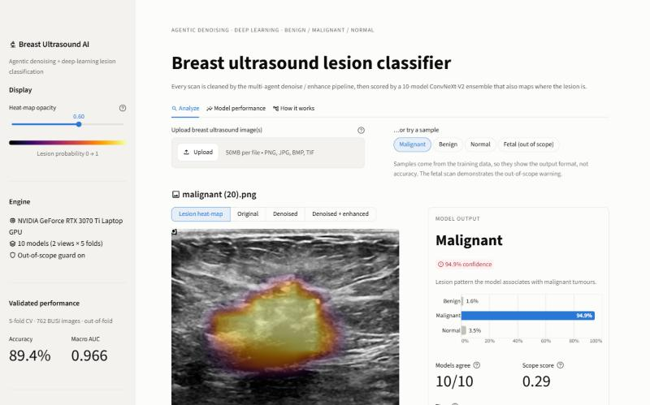
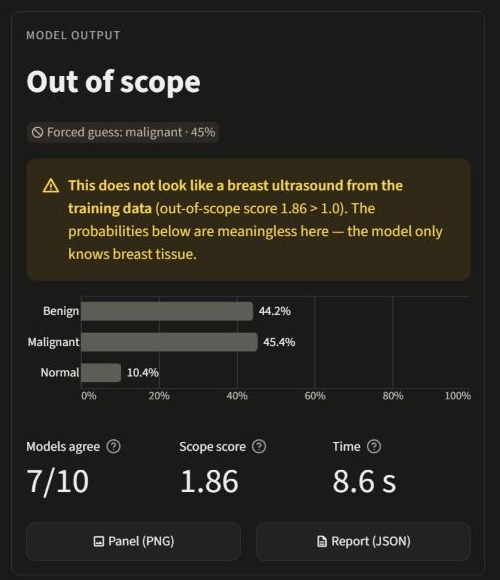

# Ultrasound disease classifier (breast: benign / malignant / normal)

Deep-learning classifier that detects breast lesions in ultrasound images
**after they have been denoised and enhanced by the agentic pipeline in
[`../../agentic_us_denoise`](../../agentic_us_denoise)**.

```
raw scan ─► Agent 1 analyse ─► Agent 2 plan ─► denoise / enhance tools ─► Agent 3 evaluate (re-plan loop)
                                   │
                ┌──────────────────┴──────────────────┐
         L4: denoised + enhanced              L2: denoised
     (Gaussian + wavelet + CLAHE + unsharp)   (Gaussian + wavelet)
                │                                     │
     ConvNeXt-V2-Tiny ×5 folds            ConvNeXt-V2-Tiny ×5 folds
                └──────────── average ────────────────┘
                                   │
          benign / malignant / normal  +  lesion heat-map  +  "not a breast scan?" guard
```

> **Research / educational use only.** This is not a medical device and its
> output is not a diagnosis.

## Results

5-fold cross-validation on 762 BUSI images (602 unique scans, duplicates kept
inside one fold). Every number is **out-of-fold**: each image is scored by
models that never saw it or any copy of it.

**Final model: ensemble of the L4 and L2 models (`predict.py` default)**

| Metric | Value |
|---|---|
| Accuracy | **89.4%** (per fold 83.6 – 93.4%) |
| Balanced accuracy | 88.3% |
| Macro F1 | 0.885 |
| Macro ROC-AUC (one-vs-rest) | **0.966** |
| Malignant: sensitivity / specificity | 87.3% / 94.8% |
| Malignant vs rest ROC-AUC | 0.969 |

| Class | Precision | Recall | F1 |
|---|---|---|---|
| benign (n=427) | 0.911 | 0.913 | 0.912 |
| malignant (n=204) | 0.860 | 0.873 | 0.866 |
| normal (n=131) | 0.890 | 0.863 | 0.876 |



### What helped (all runs on the same folds)



| Run | Input · model | Accuracy (fold ± sd) | Balanced acc | Macro AUC | Malignant sens / spec |
|---|---|---|---|---|---|
| `ensemble_L4_L2` | L4 + L2 · ConvNeXt-V2-Tiny 384px + lesion loss | **89.4%** (±3.7) | 88.3% | **0.966** | 87.3% / 94.8% |
| `final_L4` | L4 denoised + enhanced · ConvNeXt-V2-Tiny 384px + lesion loss | 88.8% (±4.9) | 86.7% | 0.952 | 86.3% / 95.3% |
| `final_L2` | L2 denoised · ConvNeXt-V2-Tiny 384px + lesion loss | 88.3% (±3.4) | 86.8% | 0.949 | 84.3% / 95.0% |
| `cmp_L2_256` | L2 denoised · ConvNeXt-Tiny 256px | 88.5% (±2.4) | 86.1% | 0.943 | 89.2% / 93.7% |
| `cmp_L0_256` | L0 raw · ConvNeXt-Tiny 256px | 86.9% (±3.5) | 82.6% | 0.946 | 89.2% / 92.8% |
| `cmp_L4_256` | L4 denoised + enhanced · ConvNeXt-Tiny 256px | 86.1% (±1.9) | 83.6% | 0.938 | 84.8% / 92.3% |
| `cmp_L4_384_seg_tiny` | L4 · ConvNeXt-Tiny 384px + lesion loss | 85.7% (±2.5) | 81.7% | 0.935 | 82.4% / 96.4% |

Findings:

* **Denoising helps; extra contrast enhancement does not, on its own.** With
  the same ConvNeXt-Tiny model, denoised L2 images beat L4 (denoise + CLAHE +
  unsharp) by 2.4 points (McNemar p = 0.018) and raw images by 1.6 points
  (p = 0.09, borderline). With the stronger backbone L2 and L4 are tied
  (88.3% vs 88.8%, p = 0.68).
* **The backbone mattered most:** ConvNeXt-V2 (FCMAE pre-training, 384 px)
  gave +3 points over ConvNeXt-Tiny on identical L4 inputs.
* **The two views are complementary:** averaging the L2 and L4 models raises
  macro AUC from 0.952 to 0.966 and accuracy to 89.4%.
* Higher resolution + lesion-mask loss alone (ConvNeXt-Tiny) did not change
  accuracy, but the lesion head gives the heat-map at prediction time, so it
  was kept.
* The remaining errors are mostly benign ↔ malignant and normal → benign
  confusions.

For context: published BUSI accuracies above ~92% are usually measured with
random splits that let duplicate scans leak between train and test.

## How the evaluation is kept honest

BUSI contains many re-saved / re-cropped copies of the same scan, which
inflates accuracy when copies land on both sides of a split.
`prepare_data.py`:

* detects near-duplicates (64×64 thumbnail correlation + perceptual hash,
  thresholds checked by eye) and groups them: **780 files → 602 unique scans**;
* removes **18 images in 8 duplicate groups whose labels contradict each
  other** (e.g. the same scan filed as both benign and malignant);
* builds 5 folds with `StratifiedGroupKFold`, so all copies of a scan stay in
  one fold;
* each fold trains for a fixed 30 epochs and keeps the last weights (no early
  stopping or checkpoint picking on the test fold).

## Setup

```bash
python -m venv C:\Users\hp\.venvs\us-disease
C:\Users\hp\.venvs\us-disease\Scripts\activate
pip install torch torchvision --index-url https://download.pytorch.org/whl/cu128
pip install -r requirements.txt
```

(The venv lives outside OneDrive on purpose, so its ~5 GB is not synced.)

Download the dataset — BUSI, Al-Dhabyani et al., *Data in Brief* 28 (2020)
104863, CC BY 4.0 — into `data/raw/`:

```bash
curl -L -o busi.zip https://huggingface.co/datasets/gymprathap/Breast-Cancer-Ultrasound-Images-Dataset/resolve/main/Breast-Cancer-Ultrasound-Images-Dataset.zip
unzip busi.zip -d data/raw
```

## Web app (Streamlit)

```bash
C:\Users\hp\.venvs\us-disease\Scripts\python.exe run_app.py
```

Then open http://localhost:8501. (Or run `streamlit run app.py` from this folder.)
The first start takes 10–30 s while the 10 models load, and the first scan
~5 s (GPU warm-up); after that a scan takes ~2 s on the RTX 3070 Ti (about 1 s
for the agents, under 1 s for the models). Results are cached, so re-opening a
scan or moving the heat-map slider is instant.



* **Analyze**: upload one or more scans (PNG/JPG/BMP/TIFF) or pick a sample.
  For each scan it shows
  * an image viewer that switches between original, denoised, denoised +
    enhanced and the lesion heat-map (opacity slider in the sidebar);
  * the prediction, the class probabilities, how many of the 10 models agree,
    and the out-of-scope score;
  * the pipeline steps as thumbnails and the agents' reports (noise level,
    plan, SNR/CNR before → after);
  * downloads: a PNG panel and a JSON report.

  Several files give a sortable batch table (with CSV export); click a row to
  inspect that scan.
* **Model performance**: out-of-fold metrics, interactive confusion matrix,
  per-class table, and the comparison of all training runs.
* **How it works**: pipeline diagram, method, data and limitations.

Non-breast images get an **"Out of scope"** headline instead of a diagnosis:



The UI follows the system light/dark setting (theme in `.streamlit/config.toml`)
and works down to phone width.

## Command line

Predict (uses the trained ensemble in `runs/final_L4` + `runs/final_L2`):

```bash
python predict.py path/to/scan.png --outdir predictions
```

```
path/to/scan.png
  prediction : MALIGNANT  (94.9%)
    benign       1.6%
    malignant   94.9%  ############################
    normal       3.5%  #
  panel      : predictions/scan_prediction.png      (original | enhanced | lesion heat-map)
```

_prediction.png)

Re-train everything from scratch (~1 h on an RTX 3070 Ti laptop GPU):

```bash
python prepare_data.py --levels 0 2 4        # dedupe, folds, masks, denoise + enhance
python train.py --level 4 --img-size 384 --batch-size 16 --arch convnextv2_tiny.fcmae_ft_in22k_in1k_384 --name final_L4
python train.py --level 2 --img-size 384 --batch-size 16 --arch convnextv2_tiny.fcmae_ft_in22k_in1k_384 --name final_L2
python fit_ood.py --run runs/final_L4         # "is this a breast ultrasound?" guard
python ensemble_eval.py runs/final_L4 runs/final_L2 --out runs/ensemble_L4_L2
python compare_runs.py                        # table + runs/comparison.png
```

`agentic_us_denoise` is expected at `../../agentic_us_denoise`; set the
`US_DENOISE_DIR` environment variable if it lives elsewhere.

## Files

| File | Purpose |
|---|---|
| `us_pipeline.py` | Calls the agentic denoise/enhance workflow (analyse → plan → process → evaluate → re-plan) |
| `prepare_data.py` | Duplicate detection, folds, lesion-mask cache, enhancement cache |
| `modeling.py` | ConvNeXt backbone + class head + lesion head; GPU augmentation |
| `train.py` | 5-fold training, out-of-fold metrics, confusion matrix, curves |
| `app.py` | Streamlit web UI (`run_app.py` starts it from any folder) |
| `inference.py` | Prediction engine shared by the UI and the CLI: enhance → ensemble → heat-map → OOD check |
| `predict.py` | Command-line prediction + PNG panels |
| `fit_ood.py` | Fits the out-of-distribution guard |
| `ensemble_eval.py` | Out-of-fold metrics of an ensemble of runs |
| `compare_runs.py` | Table / chart across runs |
| `runs/<name>/` | `metrics.json`, `oof_predictions.csv`, plots; `fold*.pt` weights for `final_*` |

## Limitations

* **Breast ultrasound only.** The classifier knows three classes of breast
  tissue and will force any image into one of them. To catch this,
  `predict.py` runs an out-of-distribution guard (Mahalanobis distance on
  generic ImageNet features) and prints a WARNING when the image is unlike the
  training scans. The fetal scan `agentic_us_denoise/scan.jpg` scores 1.86 and
  the synthetic phantom 1.90 (threshold 1.0; ~1% of genuine unseen BUSI scans
  exceed it). It catches clearly different images, not subtle shifts such as a
  different breast-ultrasound machine.
* BUSI comes from one hospital (Baheya Hospital, Cairo, 2018). Expect lower
  accuracy on other scanners until the model is validated / fine-tuned there.
* ~600 unique scans is small: fold-to-fold spread is ±3–5 points, so
  differences under ~2 points between runs are within noise.
* The example predictions above use BUSI images that the models trained on;
  they show the output format, not accuracy (accuracy is the out-of-fold table).
